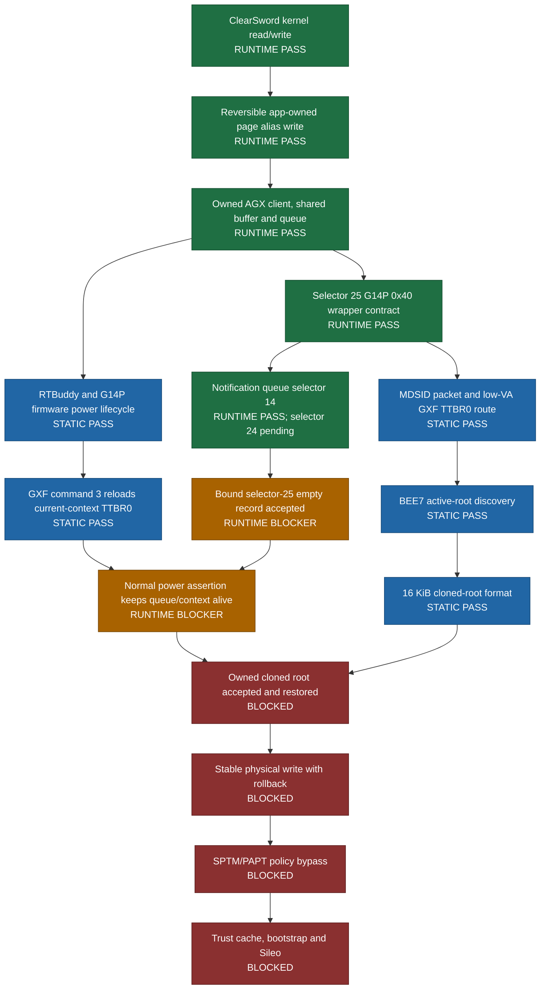

# Dopamine

A rootless semi-untethered jailbreak for iOS 15.0 - 17.3.1 (arm64e), iOS 15.0 - 18.7.1, 26.0 - 26.0.1 (A12/A13) and iOS 15.0 - 18.7.1 (arm64). More details will follow here soon.

Please note that all issues related to version support will be deleted without response.

Official website / download: https://ellekit.space/dopamine/

## Private A15 / iOS 26 research status

Last updated: 2026-10-20. Exact target: iPhone14,2, iOS 26.0.1,
build 23A355. Private research branch:
`codex/a15-ios26-private-research`.

This branch is research in progress, not a working jailbreak release. A stage
is marked `RUNTIME PASS` only after its effect is observed on the target phone.
`STATIC PASS` means that the route is closed on the exact firmware images but
has not yet been exercised safely on-device.

### Current deployment gate

ABI v3 ran once without a restart. The `0x40` record contract passed, but the
single selector-25 call returned `0xe00002bc`; all queue and firmware snapshots
remained unchanged. Exact-image control flow proves that this value is returned
before backend allocation when `queue+0x428` is null. The missing prerequisite
is therefore the normal IOGPU notification queue, not another record-size guess.

The first notification-bound run reached selector 14 and created its owned
notification queue, then stopped at a vtable guard before selector 24 or
selector 25. Exact-image analysis corrected that guard from
`0xfffffff007e42f28` to `0xfffffff007e479a8`. The only justified next device
run is the verified bounded
`self-page-write-v1+agx-notification-vtable-v2+rtkit-mmio-disabled-v1` probe.
It creates one notification queue with selector 14, binds it once with selector
24, verifies `queue+0x428` and `queue+0x430`, then makes at most one
selector-25 call. It does not install a replacement root, force a power
transition, perform GPU MMIO, write physical memory, or modify protected
memory.

Last device-tested private build (v4, retired at the vtable guard):

| Field | Value |
| --- | --- |
| Source commit | `ecb789d505fef44aed3088c5f0af34ffcf1ac6f9` |
| GitHub Actions run | [`39387291888`](https://github.com/Philiphall6/Dopamine-private/actions/runs/39387291888) (`success`) |
| IPA SHA-256 | `541A21AC39E652DBF4B6C7825925E1670BA8C4B86BAADA4EBCF54542E1CC9EEC` |
| Embedded revision | `self-page-write-v1+agx-notification-bound-zero-packet-v1+rtkit-mmio-disabled-v1` |
| Safety mode | `no-gfx-mmio` |
| Probe markers | `titan.notification-binding.link`, `titan.zero-packet.record-contract` |
| Device result | Selector 14 passed; vtable guard stopped before selectors 24 and 25 |
| Call boundary | One selector 14, one selector 24, at most one selector 25 |
| Compiled evidence | selectors `0x0e`, `0x18`, `0x19`; queue offsets `0x428/+0x430`; record `0x40` |

Last device-tested private build (ABI v3, retired):

| Field | Value |
| --- | --- |
| Source commit | `0ec47e4e2a1dd27ad57f4ee1e226124a3c27206f` |
| GitHub Actions run | [`39384824664`](https://github.com/Philiphall6/Dopamine-private/actions/runs/39384824664) (`success`) |
| IPA SHA-256 | `F4F98891E9BC2998BBB94207BC53F5528EF012FA92D898554F520DC3E891C8AB` |
| Embedded revision | `self-page-write-v1+agx-zero-packet-abi-v3+rtkit-mmio-disabled-v1` |
| Safety mode | `no-gfx-mmio` |
| Probe marker | `titan.zero-packet.record-contract` |
| Compiled ABI evidence | `device+0x268`, compare/record size `0x40`, selector `0x19` |
| Call boundary | Exactly one `_IOConnectCallMethod` call in `_titan_probe_zero_packet_once` |
| Device result | `0xe00002bc`, unchanged state, missing `queue+0x428` prerequisite |

The exact selector-25 batch reads `queue+0x428` before either the backend or
parser. Selector 14 creates a 256-by-32-byte `IOGPUNotificationQueue` and
registers it under `client-table+0x90`; selector 24 stores the derived object at
`queue+0x428` and the queue object through `queue+0x430`. The exact selector-14
factory installs notification vtable `0xfffffff007e479a8`; v2 validates this
identity before the one-call selector-25 boundary.

The build is not a jailbreak release. Sileo and bootstrap deployment remain
blocked behind selector-25 acceptance, power-lifecycle survival, reversible
root replacement, a stable physical-write primitive and the SPTM/PAPT policy
boundary.

Deployment order:

1. Trigger the private GitHub Actions workflow manually for one exact commit;
   documentation and source pushes do not build automatically.
2. Build one IPA from that commit and verify its embedded revision.
3. Install and run it once on the exact target; do not retry automatically.
4. Accept promotion only if the call contract and cleanup observations pass.
5. Then build a separate power-lifecycle observation that checks queue, buffer,
   context and registered-root stability.
6. Root replacement, physical writes and SPTM work stay disabled until their
   restoration contracts are independently complete.

### Evidence and maintenance

- Functional ledger: [`docs/A15_IOS26_OFFLINE_FUNCTIONAL_PATH_2026_10_19.md`](docs/A15_IOS26_OFFLINE_FUNCTIONAL_PATH_2026_10_19.md)
- Blocker schema: [`docs/A15_IOS26_CHAIN_BLOCKERS_SCHEMA_2026_10_19.md`](docs/A15_IOS26_CHAIN_BLOCKERS_SCHEMA_2026_10_19.md)
- Detailed worklog: [`docs/A15_IOS26_WORKLOG.md`](docs/A15_IOS26_WORKLOG.md)
- Current private build: [`docs/A15_IOS26_PRIVATE_BUILD_V4_2026_10_20.md`](docs/A15_IOS26_PRIVATE_BUILD_V4_2026_10_20.md)
- Latest device-tested private build: [`docs/A15_IOS26_PRIVATE_BUILD_V3_2026_10_20.md`](docs/A15_IOS26_PRIVATE_BUILD_V3_2026_10_20.md)
- Retired v2 private build: [`docs/A15_IOS26_PRIVATE_BUILD_2026_10_20.md`](docs/A15_IOS26_PRIVATE_BUILD_2026_10_20.md)
- Current G14P ABI: [`docs/A15_IOS26_AGX_ZERO_PACKET_ABI_V3_2026_10_20.md`](docs/A15_IOS26_AGX_ZERO_PACKET_ABI_V3_2026_10_20.md)
- Notification prerequisite: [`docs/A15_IOS26_AGX_NOTIFICATION_BINDING_V1_2026_10_20.md`](docs/A15_IOS26_AGX_NOTIFICATION_BINDING_V1_2026_10_20.md)
- V4 log triage: [`tools/a15_ios26/triage_agx_notification_bound_probe.py`](tools/a15_ios26/triage_agx_notification_bound_probe.py)
- Power lifecycle audit: [`tools/a15_ios26/audit_agx_firmware_power_lifecycle.py`](tools/a15_ios26/audit_agx_firmware_power_lifecycle.py)

Keep this section synchronized whenever a stage changes state or a new IPA is
promoted. Extracted Apple firmware, phone journals, signing material and local
IPA artifacts are intentionally excluded from Git.
