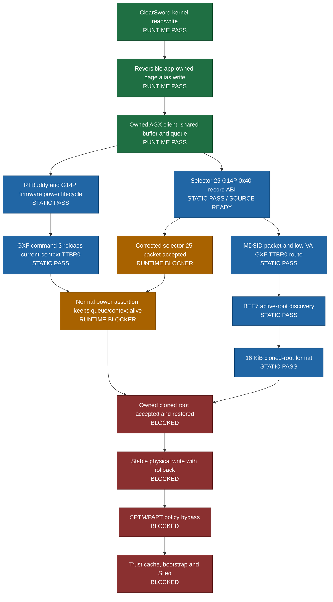

# Dopamine

A rootless semi-untethered jailbreak for iOS 15.0 - 17.3.1 (arm64e), iOS 15.0 - 18.7.1, 26.0 - 26.0.1 (A12/A13) and iOS 15.0 - 18.7.1 (arm64). More details will follow here soon.

Please note that all issues related to version support will be deleted without response.

Official website / download: https://ellekit.space/dopamine/

## Private A15 / iOS 26 research status

Last updated: 2026-10-20. Exact target: iPhone14,2, iOS 26.0.1,
build 23A355. Private research branch:
`codex/a15-ios26-private-research`.

This branch is research in progress, not a working jailbreak release. A stage
is marked `RUNTIME PASS` only after its effect is observed on the target phone.
`STATIC PASS` means that the route is closed on the exact firmware images but
has not yet been exercised safely on-device.

### Current deployment gate

The only justified next device build is the bounded
`self-page-write-v1+agx-zero-packet-abi-v3+rtkit-mmio-disabled-v1` probe. It
submits at most one selector-25 record of `0x40` bytes, records pre/post state,
and stops. It does not install a replacement root, force a power transition,
perform GPU MMIO, write physical memory, or modify protected memory.

Last device-tested private build (retired):

| Field | Value |
| --- | --- |
| Source commit | `20e28f2d5dea8ac6c3737074575b4d55d92bed70` |
| GitHub Actions run | [`39383221146`](https://github.com/Philiphall6/Dopamine-private/actions/runs/39383221146) (`success`) |
| IPA SHA-256 | `8566FC2D517D7B144964005E9EB06DC18977D6B0ADAD3DDD863A2B2799F70806` |
| Embedded revision | `self-page-write-v1+agx-zero-packet-abi-v2+rtkit-mmio-disabled-v1` |
| Safety mode | `no-gfx-mmio` |
| Probe marker | `titan.zero-packet.record-contract` |
| Compiled ABI evidence | `device+0x268`, compare/record size `0x30`, selector `0x19` |
| Call boundary | Exactly one `_IOConnectCallMethod` call in `_titan_probe_zero_packet_once` |
| Device result | Stable `device+0x268=0x40/0x40`; stopped before `_IOConnectCallMethod` |

The v2 run completed without a restart. Its static `0x30` expectation was the
IOGPU base-class default, not the active G14P contract. Exact AGXG14P code at
`0xfffffff0087e7344..0xfffffff0087e7350` overwrites `device+0x268` with
`0x40` and then writes the independently observed queue-input size `0x410` to
`device+0x278`. ABI v3 uses this joined static/runtime evidence and retains
the one-call limit.

The build is not a jailbreak release. Sileo and bootstrap deployment remain
blocked behind selector-25 acceptance, power-lifecycle survival, reversible
root replacement, a stable physical-write primitive and the SPTM/PAPT policy
boundary.

Deployment order:

1. Trigger the private GitHub Actions workflow manually for one exact commit;
   documentation and source pushes do not build automatically.
2. Build one IPA from that commit and verify its embedded revision.
3. Install and run it once on the exact target; do not retry automatically.
4. Accept promotion only if the call contract and cleanup observations pass.
5. Then build a separate power-lifecycle observation that checks queue, buffer,
   context and registered-root stability.
6. Root replacement, physical writes and SPTM work stay disabled until their
   restoration contracts are independently complete.

### Evidence and maintenance

- Functional ledger: [`docs/A15_IOS26_OFFLINE_FUNCTIONAL_PATH_2026_10_19.md`](docs/A15_IOS26_OFFLINE_FUNCTIONAL_PATH_2026_10_19.md)
- Blocker schema: [`docs/A15_IOS26_CHAIN_BLOCKERS_SCHEMA_2026_10_19.md`](docs/A15_IOS26_CHAIN_BLOCKERS_SCHEMA_2026_10_19.md)
- Detailed worklog: [`docs/A15_IOS26_WORKLOG.md`](docs/A15_IOS26_WORKLOG.md)
- Verified private build: [`docs/A15_IOS26_PRIVATE_BUILD_2026_10_20.md`](docs/A15_IOS26_PRIVATE_BUILD_2026_10_20.md)
- Current G14P ABI: [`docs/A15_IOS26_AGX_ZERO_PACKET_ABI_V3_2026_10_20.md`](docs/A15_IOS26_AGX_ZERO_PACKET_ABI_V3_2026_10_20.md)
- Power lifecycle audit: [`tools/a15_ios26/audit_agx_firmware_power_lifecycle.py`](tools/a15_ios26/audit_agx_firmware_power_lifecycle.py)

Keep this section synchronized whenever a stage changes state or a new IPA is
promoted. Extracted Apple firmware, phone journals, signing material and local
IPA artifacts are intentionally excluded from Git.
