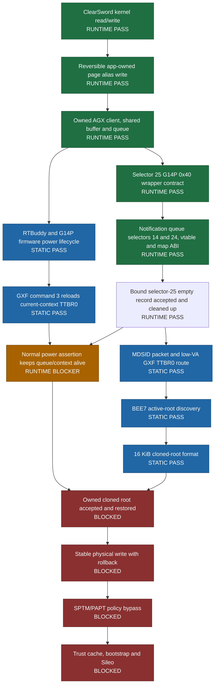

# Dopamine

A rootless semi-untethered jailbreak for iOS 15.0 - 17.3.1 (arm64e), iOS 15.0 - 18.7.1, 26.0 - 26.0.1 (A12/A13) and iOS 15.0 - 18.7.1 (arm64). More details will follow here soon.

Please note that all issues related to version support will be deleted without response.

Official website / download: https://ellekit.space/dopamine/

## Private A15 / iOS 26 research status

Last updated: 2026-10-20. Exact target: iPhone14,2, iOS 26.0.1,
build 23A355. Private research branch:
`codex/a15-ios26-private-research`.

This branch is research in progress, not a working jailbreak release. A stage
is marked `RUNTIME PASS` only after its effect is observed on the target phone.
`STATIC PASS` means that the route is closed on the exact firmware images but
has not yet been exercised safely on-device.

### Current deployment gate

The notification-map v3 build completed one bounded run without a restart.
Selector 14 created the owned notification queue, selector 24 bound it, and
`queue+0x428` was populated. The one selector-25 call then accepted the empty
`0x40` record with `kr=0x0`. The pool digest, buffer contents and tracked
identities were stable before and after the call; only the expected dispatch and
command-index counters advanced from `0` to `1`. Connection cleanup passed.

This closes the empty-record gate, not the jailbreak chain. No nonempty MDSID
record has been submitted. The next activity is an offline review of the exact
MDSID parser and cleanup boundaries. The exact-image audit establishes the
static route, but explicitly leaves final deallocation timing and complete
nonempty-packet effects unobserved. Its machine-readable gate is therefore
`STATIC_ROUTE_ONLY_NO_GO`, which explicitly denies a device submission. A
separate source revision and a fresh, explicitly bounded review are required
before any further device experiment.

The offline correlation gate now also joins that exact-image result with the
read-only live callback identities and the accepted empty-record journal. Even
when all three inputs are present, it emits
`STATIC_AND_EMPTY_ROUTE_EVIDENCED_NO_GO` and
`device_submission_authorized: false`; it is deliberately incapable of
upgrading evidence into permission for a nonempty record.

The apparent final `titan.run FAIL return=-1` is the probe runner's deliberate
stop after a completed bounded stage; the preceding `titan.zero-packet PASS`
and `titan.own-queue PASS` lines are the relevant operation results.

Last device-tested private build (notification-map v3, empty-record gate passed):

| Field | Value |
| --- | --- |
| Source commit | `a91336d4f2a3e3ae9dd52d2bc43b72e852f39c87` |
| GitHub Actions run | [`39392906389`](https://github.com/Philiphall6/Dopamine-private/actions/runs/39392906389) (`success`) |
| IPA SHA-256 | `9DAFDD799ED35053DEA7281850AD3EAEE64FE237CC3D5026E90686A0D2174C26` |
| Embedded revision | `self-page-write-v1+agx-notification-map-v3+rtkit-mmio-disabled-v1` |
| Safety mode | `no-gfx-mmio` |
| Device result | Selectors 14, 24 and 25 each completed once; selector 25 returned `0x0`; empty-record cleanup observed |
| Excluded work | MDSID/nonempty records, power transitions, GPU MMIO, physical/protected writes, root replacement, bootstrap and Sileo |

Last device-tested private build (notification-vtable v2, retired at the map guard):

| Field | Value |
| --- | --- |
| Source commit | `738ed6dee90553e80fded42b887fa181decd486b` |
| GitHub Actions run | [`39390670856`](https://github.com/Philiphall6/Dopamine-private/actions/runs/39390670856) (`success`) |
| IPA SHA-256 | `5F0ED6D13922C81948F717739642E525D1B0ABFB7755338CA6589A1A2840E6EE` |
| Embedded revision | `self-page-write-v1+agx-notification-vtable-v2+rtkit-mmio-disabled-v1` |
| Safety mode | `no-gfx-mmio` |
| Device result | Selector 14 and notification vtable passed; map `0x2454` stopped before selectors 24 and 25 |
| Call boundary reached | One selector 14; zero selectors 24 and 25 |

Last device-tested private build (v4, retired at the vtable guard):

| Field | Value |
| --- | --- |
| Source commit | `ecb789d505fef44aed3088c5f0af34ffcf1ac6f9` |
| GitHub Actions run | [`39387291888`](https://github.com/Philiphall6/Dopamine-private/actions/runs/39387291888) (`success`) |
| IPA SHA-256 | `541A21AC39E652DBF4B6C7825925E1670BA8C4B86BAADA4EBCF54542E1CC9EEC` |
| Embedded revision | `self-page-write-v1+agx-notification-bound-zero-packet-v1+rtkit-mmio-disabled-v1` |
| Safety mode | `no-gfx-mmio` |
| Probe markers | `titan.notification-binding.link`, `titan.zero-packet.record-contract` |
| Device result | Selector 14 passed; vtable guard stopped before selectors 24 and 25 |
| Call boundary | One selector 14, one selector 24, at most one selector 25 |
| Compiled evidence | selectors `0x0e`, `0x18`, `0x19`; queue offsets `0x428/+0x430`; record `0x40` |

Last device-tested private build (ABI v3, retired):

| Field | Value |
| --- | --- |
| Source commit | `0ec47e4e2a1dd27ad57f4ee1e226124a3c27206f` |
| GitHub Actions run | [`39384824664`](https://github.com/Philiphall6/Dopamine-private/actions/runs/39384824664) (`success`) |
| IPA SHA-256 | `F4F98891E9BC2998BBB94207BC53F5528EF012FA92D898554F520DC3E891C8AB` |
| Embedded revision | `self-page-write-v1+agx-zero-packet-abi-v3+rtkit-mmio-disabled-v1` |
| Safety mode | `no-gfx-mmio` |
| Probe marker | `titan.zero-packet.record-contract` |
| Compiled ABI evidence | `device+0x268`, compare/record size `0x40`, selector `0x19` |
| Call boundary | Exactly one `_IOConnectCallMethod` call in `_titan_probe_zero_packet_once` |
| Device result | `0xe00002bc`, unchanged state, missing `queue+0x428` prerequisite |

The exact selector-25 batch reads `queue+0x428` before either the backend or
parser. Selector 14 creates a 256-by-32-byte `IOGPUNotificationQueue` and
registers it under `client-table+0x90`; selector 24 stores the derived object at
`queue+0x428` and the queue object through `queue+0x430`. The exact selector-14
factory installs notification vtable `0xfffffff007e479a8`. All of these
relationships are now observed on the target in the bounded empty-record run.

The build is not a jailbreak release. Sileo and bootstrap deployment remain
blocked behind the nonempty MDSID review, power-lifecycle survival, reversible
root replacement, a stable physical-write primitive and the SPTM/PAPT policy
boundary.

The current lifecycle-hardening revision is AGX lifecycle V3 and remains
offline-only. It adds a manual macOS compile-check workflow and an offline
JSONL audit while preserving V2's resource/error contract; it does not
promote a new IPA or authorize a device run.

The V5 compile validation was inspected from private Actions run
[`39437143268`](https://github.com/Philiphall6/Dopamine-private/actions/runs/39437143268).
That run proved `Titan.framework` compilation, inclusion of the modified
`Application/Dopamine/Exploits/Titan/exploit/titan.m` Objective-C source, and
315 offline Python tests. Its compile used the Xcode 26.5 SDK while targeting
iOS 16.1, so the workflow now downloads and selects the iPhoneOS 16.5 SDK
explicitly for the next verification run. This remains a compile-only check;
it does not produce an IPA, install anything, or validate a jailbreak.

Deployment order:

1. Trigger the private GitHub Actions workflow manually for one exact commit;
   documentation and source pushes do not build automatically.
2. Build one IPA from that commit and verify its embedded revision.
3. Install and run it once on the exact target; do not retry automatically.
4. Preserve the accepted empty-record evidence and complete the offline
   nonempty MDSID parser/cleanup review.
5. Review any future MDSID probe as a separate source change and artifact;
   no automatic device run or retry is permitted.
6. Root replacement, physical writes and SPTM work stay disabled until their
   restoration contracts are independently complete.

### Evidence and maintenance

- Functional ledger: [`docs/A15_IOS26_OFFLINE_FUNCTIONAL_PATH_2026_10_19.md`](docs/A15_IOS26_OFFLINE_FUNCTIONAL_PATH_2026_10_19.md)
- Blocker schema: [`docs/A15_IOS26_CHAIN_BLOCKERS_SCHEMA_2026_10_19.md`](docs/A15_IOS26_CHAIN_BLOCKERS_SCHEMA_2026_10_19.md)
- Detailed worklog: [`docs/A15_IOS26_WORKLOG.md`](docs/A15_IOS26_WORKLOG.md)
- Accepted empty-record run: [`docs/A15_IOS26_EMPTY_RECORD_ACCEPTED_V3_2026_10_20.md`](docs/A15_IOS26_EMPTY_RECORD_ACCEPTED_V3_2026_10_20.md)
- Current private build contract: [`docs/A15_IOS26_NOTIFICATION_MAP_V3_2026_10_20.md`](docs/A15_IOS26_NOTIFICATION_MAP_V3_2026_10_20.md)
- Retired v2 private build: [`docs/A15_IOS26_PRIVATE_BUILD_2026_10_20.md`](docs/A15_IOS26_PRIVATE_BUILD_2026_10_20.md)
- Current G14P ABI: [`docs/A15_IOS26_AGX_ZERO_PACKET_ABI_V3_2026_10_20.md`](docs/A15_IOS26_AGX_ZERO_PACKET_ABI_V3_2026_10_20.md)
- Notification prerequisite: [`docs/A15_IOS26_AGX_NOTIFICATION_BINDING_V1_2026_10_20.md`](docs/A15_IOS26_AGX_NOTIFICATION_BINDING_V1_2026_10_20.md)
- Nonempty MDSID runtime gate: [`tools/a15_ios26/audit_agx_submit_boundary.py`](tools/a15_ios26/audit_agx_submit_boundary.py)
- MDSID evidence correlation no-go: [`docs/A15_IOS26_MDSID_READINESS_NO_GO_2026_10_20.md`](docs/A15_IOS26_MDSID_READINESS_NO_GO_2026_10_20.md)
- Correlation tool: [`tools/a15_ios26/triage_agx_mdsid_readiness.py`](tools/a15_ios26/triage_agx_mdsid_readiness.py)
- V4 log triage: [`tools/a15_ios26/triage_agx_notification_bound_probe.py`](tools/a15_ios26/triage_agx_notification_bound_probe.py)
- Power lifecycle audit: [`tools/a15_ios26/audit_agx_firmware_power_lifecycle.py`](tools/a15_ios26/audit_agx_firmware_power_lifecycle.py)
- AGX lifecycle diagnostic: [`docs/A15_IOS26_AGX_LIFECYCLE_DIAGNOSTIC_V1_2026_10_20.md`](docs/A15_IOS26_AGX_LIFECYCLE_DIAGNOSTIC_V1_2026_10_20.md)
- AGX lifecycle V2: [`docs/A15_IOS26_AGX_LIFECYCLE_V2_2026_10_20.md`](docs/A15_IOS26_AGX_LIFECYCLE_V2_2026_10_20.md)
- AGX lifecycle V2 offline tests: [`tools/a15_ios26/test_agx_lifecycle_v2.py`](tools/a15_ios26/test_agx_lifecycle_v2.py)
- AGX lifecycle V3: [`docs/A15_IOS26_AGX_LIFECYCLE_V3_2026_10_20.md`](docs/A15_IOS26_AGX_LIFECYCLE_V3_2026_10_20.md)
- Build validation V5: [`docs/A15_IOS26_BUILD_VALIDATION_V5_2026_10_20.md`](docs/A15_IOS26_BUILD_VALIDATION_V5_2026_10_20.md)
- AGX lifecycle log audit: [`tools/a15_ios26/audit_agx_lifecycle_log.py`](tools/a15_ios26/audit_agx_lifecycle_log.py)
- Manual macOS compile check: [`.github/workflows/a15-ios26-compile-check.yml`](.github/workflows/a15-ios26-compile-check.yml)

Keep this section synchronized whenever a stage changes state or a new IPA is
promoted. Extracted Apple firmware, phone journals, signing material and local
IPA artifacts are intentionally excluded from Git.
